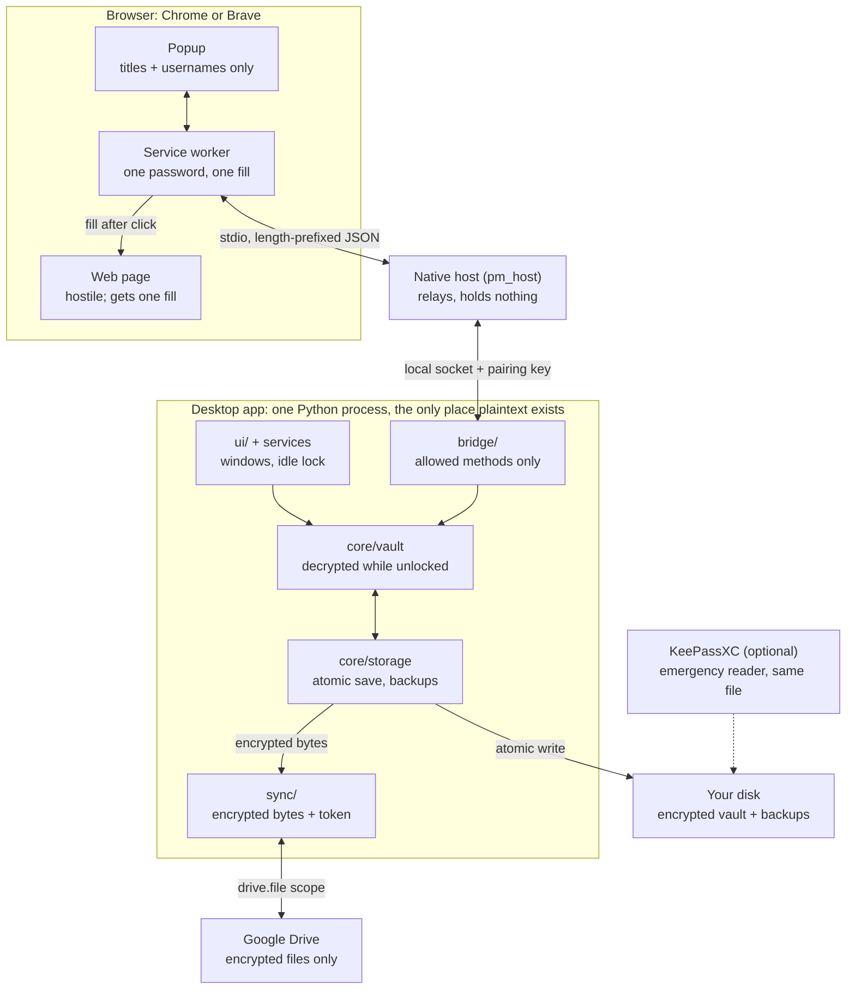

# Architecture

> Source: design pack draft v0.1, sections 4, 7, 8 and 9. Status: proposed until gate G0.

One desktop process holds every decrypted secret. Everything else (the browser, the native
host, Google Drive and the backups) only ever sees encrypted bytes, or a single answer to a
single request.

## Overview



## Components

| Component | Runs where | Sees plaintext? | Job |
| --- | --- | --- | --- |
| `core/vault` (`VaultSession`) | Desktop app | Yes, while unlocked | Open, lock, add, edit, delete and search one profile's KDBX file |
| `core/storage` | Desktop app | No, encrypted bytes only | Atomic save, read-back check, rotating backups, recovery |
| `core/profiles` | Desktop app | No | List, create, rename and delete profiles in `profiles.json` |
| `core/generator` | Desktop app | Generates, never stores | Random passwords from `secrets` |
| `ui/` (PySide6) | Desktop app | Shows one entry at a time | Profile picker, unlock, list, forms, settings, sync status, idle timer |
| `sync/` | Desktop app, background thread | No: encrypted bytes and an OAuth token | Upload, download, detect conflicts, retry |
| `bridge/` | Desktop app | Answers narrow questions | Local socket server for the browser; calls only the allowed `VaultSession` methods |
| Native host (`pm_host`) | Separate process started by the browser | Relays one password per fill, holds nothing | Converts browser stdin/stdout messages to the local socket |
| Extension service worker | Browser | One password, for one fill, in memory only | Holds the native port, routes messages, injects the fill |
| Extension popup | Browser | Titles and usernames for this site | The only extension UI |
| Google Drive | Google | Never | Stores encrypted `.kdbx` files and their revisions |
| KeePassXC (optional) | Your computer or phone | When you open a vault in it | Emergency reader and recovery tool |

## Layer rules

These rules are enforced in CI by import-linter.

- `core/` never imports Qt, `sync/` or `bridge/`, so core logic can be tested without a
  screen or a network.
- `sync/` never imports `core/vault`. It receives encrypted bytes and a token, nothing else.
  The one exception is the merge step in M6, which goes through a single function that the
  owner reviews.
- `bridge/` may call only the methods listed in the [browser protocol](#messages).
- `ui/` talks to core only through `services.py`, never to pykeepass directly.

## Key flows

**Unlock**

1. The app starts and reads `profiles.json` (names and file paths only).
2. You pick a profile and type the master password into the desktop window.
3. `storage` reads the encrypted file, and `VaultSession` decrypts it through pykeepass.
4. The idle timer starts. If the profile is linked to Drive, the sync engine starts.

**Save**

1. The UI sends the change to `VaultSession`.
2. `storage` writes a temp file in the same folder, flushes it to disk, and re-opens it to
   prove it decrypts.
3. The previous file moves into the backup rotation, and the temp file atomically replaces
   the vault.
4. The vault is marked "needs upload". The sync engine uploads it after a 10-second quiet
   period.

**Fill a login**

1. You click the toolbar icon. Through the host and the socket, the popup asks the app for
   logins that match the tab's hostname.
2. The app returns titles and usernames only.
3. You click one. The app re-checks the hostname and returns that one password.
4. The service worker injects a fill function into the tab's top frame, then drops the
   password.

**Lock** (manual, idle timeout or system sleep)

1. `VaultSession` drops its pykeepass object and caches. The clipboard is cleared if it
   still holds a copied password.
2. The sync engine pauses, and the bridge answers every request with `locked`.

## Google Drive sync

The rule: sync never overwrites a version it has not seen. In v1 a true conflict stops sync
and keeps both copies. Automatic entry-level merge arrives in M6.

### Permissions and sign-in

- Scope: `https://www.googleapis.com/auth/drive.file` only. The app sees only files it
  created. Google classes this scope as non-sensitive, so no security assessment is needed.
- OAuth client type: Desktop app, loopback redirect with PKCE, via `google-auth-oauthlib`.
- Each user creates their own Google Cloud project and OAuth client. `client_secret.json`
  is git-ignored, and `docs/setup-google-drive.md` (planned for M5) walks through the setup.
- Set the consent screen to **In production**. In Testing mode, Google expires refresh
  tokens after 7 days, which looks like random sync breakage.
- The refresh token lives inside the profile's vault (`.app/drive-sync`), so sync runs only
  while that profile is unlocked.

### Drive layout

```text
My Drive/PersonalVault/<profile_id>/vault.kdbx
```

The file carries `appProperties` `{"pm_profile_id": "...", "pm_schema": "1"}`, so the app
can find it again if `state.json` is lost.

### Decision rule

The sync engine is a pure function, `decide(local, remote, state) -> Action`, with no
network or disk access, so it can be tested exhaustively. A separate executor performs the
action.

| Local changed since last sync | Remote changed since last sync | Action |
| --- | --- | --- |
| No | No | Nothing |
| Yes | No | Upload, and record the new remote version |
| No | Yes | Download to `incoming/`, verify it decrypts, back up local, adopt atomically |
| Yes | Yes | Conflict: save remote to `conflicts/`, upload nothing, show a banner |
| Either | File missing or trashed | Stop and ask; never recreate silently |
| Either | Same content on both sides | Update `state.json` only |

"Remote changed" means the Drive `md5Checksum` differs from `last_synced_remote_md5`.
"Local changed" means `local_dirty` is set, or the local SHA-256 differs from
`last_synced_local_sha256`.

### Closing the race window

Drive v3 has no atomic "upload only if unchanged" call, so another device could write
between our check and our upload. The engine handles this in three steps:

1. Re-read the remote checksum immediately before uploading.
2. After uploading, list the file's revisions since the last synced version.
3. If any revision other than ours appears, download it to `conflicts/` and raise a
   conflict. Drive keeps earlier revisions, so nothing is lost silently.

### Resolving a conflict (v1)

- **Keep mine:** upload local. The remote copy stays in `conflicts/` and in Drive's revision
  history.
- **Take theirs:** adopt remote. Local goes to `backups/`.
- **Open both:** open the remote copy read-only beside yours, to copy entries by hand.
  Automatic merge replaces this in M6.

### When sync runs

Sync runs on unlock, 10 seconds after the last save, every 60 minutes while unlocked, when
the network returns, and on "Sync now". Only one sync runs at a time per profile.

### Errors and retries

| Error | Behaviour |
| --- | --- |
| No network, timeout, HTTP 5xx, 429 | Retry with backoff of 30 s, 1, 2, 4, 8, 16 and 30 min (the cap), with jitter |
| HTTP 401 | Refresh the access token once, then retry |
| `invalid_grant` on refresh | Status "Reconnect Google"; local use continues |
| Downloaded file fails to decrypt | Keep it in `incoming/` and do not adopt it; status "Remote file unreadable" |
| Disk full while adopting | Abort; by design the original vault is untouched |

Statuses shown in the UI: Synced, Waiting to upload, Offline (retrying at a shown time),
Conflict (action needed), Reconnect Google, Sync off.

### Testing

A `FakeDrive` class implements the same interface as the real client, in memory. Tests can
inject a write from "another device" at any step, drop the network, return 429s or corrupt a
download. The real client gets a small manual smoke test against a throwaway Google account.

## Browser extension and native messaging

The extension is a thin remote control. It asks the desktop app for logins that match the
current tab, and fills one password after you click. It stores no vault data, and the
protocol has no message that returns more than one password.

### Extension (Manifest V3, plain JavaScript)

| Piece | File | Job |
| --- | --- | --- |
| Manifest | `manifest.json` | Permissions: `nativeMessaging`, `activeTab`, `scripting`, `storage`. A fixed key keeps the extension ID stable during development. |
| Service worker | `background.js` | Owns the native port, reads the active tab's URL, injects the fill |
| Popup | `popup.html`, `popup.js` | Lists matches, with fill buttons, lock and unlock buttons, and an "add login for this site" form |
| Fill function | `fill.js` | Injected on click into the top frame only; fills visible fields, never submits |
| Save detector (M4b) | `detect.js` | Content script that notices a submitted login; needs access to all sites |
| Browser shim | `api.js` | Wraps `chrome.*` so Firefox's `browser.*` can be added later |

M4a needs no access to any website until you click, because `activeTab` grants access to that
one tab. M4b's save detection needs permission to read all sites, so it is a separate step
with its own approval.

### Native host

- Name `com.personalvault.host`, type `stdio`. `allowed_origins` lists only our extension ID.
- `scripts/install_native_host.py` writes the host manifest for Chrome and Brave on your OS.
  The exact paths are recorded in `docs/setup-browser.md`.
- The host holds no state. It reads one framed message, forwards it to the app's local
  socket, and writes back the reply.
- Framing: a 4-byte length in native byte order, then UTF-8 JSON. Chrome caps host-to-browser
  messages at 1 MB. Our host rejects requests over 16 KB, and our replies stay under 64 KB.
- Local socket: a Qt local socket (a named pipe on Windows, a Unix socket elsewhere) that
  only your OS user can read.

### Message envelope

```json
{ "v": 1, "id": "8f14e45f-...", "type": "get_logins", "pairing_key": "base64...",
  "payload": { "url": "https://github.com/login" } }

{ "v": 1, "id": "8f14e45f-...", "ok": false, "error": { "code": "locked" } }
```

Error codes: `locked`, `not_paired`, `no_match`, `url_mismatch`, `bad_request`, `too_large`,
`rate_limited`, `app_not_running`, `internal`. Unknown fields or types are rejected, never
ignored.

### Messages

| Type | Needs pairing | Payload | Returns | Rules |
| --- | --- | --- | --- | --- |
| `hello` | No | Extension version | App version, `locked` or `unlocked`, profile name | No vault data |
| `pair_request` | No | New 32-byte key, browser name | `paired: true` | You confirm in the desktop app; both sides show the same 6-character code; 60-second timeout |
| `show_unlock` | No | None | `shown: true` | Brings the desktop unlock window forward |
| `get_logins` | Yes | Tab URL | Up to 20 of `{id, title, username}` | Matching rules from the [data model](data-model.md#site-matching-rules) |
| `get_secret` | Yes | Entry ID, tab URL | `{username, password}` | The app re-matches the URL against that entry; 10 per minute |
| `save_login` | Yes | URL, username, password, optional title | New entry ID | Always creates; never overwrites |
| `update_password` | Yes | Entry ID, URL, new password | Entry ID | URL must match; the old password goes to history |
| `generate_password` | No | Optional length | Password | Generator only, no vault access |
| `lock` | Yes | None | None | Locks the vault |

There is deliberately no message to list all entries, search by free text, export, or change
settings.

### Fill procedure

1. You click the toolbar icon or press the shortcut. The service worker reads the active
   tab's URL itself; the page never supplies it.
2. `get_logins` returns the matches, and the popup shows titles and usernames.
3. You click one. The service worker re-reads the tab URL and aborts if it changed since
   step 1.
4. `get_secret` returns that login. The service worker injects `fill.js` into frame 0, with
   the username and password as arguments.
5. `fill.js` fills only visible fields (non-zero size, not hidden, not transparent), fires
   `input` and `change` events, and does not submit.
6. The service worker drops its references, and the popup closes.

### Save and update (M4b)

1. `detect.js` notices a submitted form with a password field and sends the candidate to the
   service worker.
2. The service worker keeps it in `chrome.storage.session` (memory only) for 2 minutes and
   shows a badge.
3. You open the popup and choose Save, Update existing or Dismiss. Nothing is saved without
   that click.

### Locked or not running

If the vault is locked, the popup shows "Unlock in app", which sends `show_unlock`. If the
app is not running, the popup says so and asks you to start it.

### Making it your primary manager

`docs/setup-browser.md` (M4) will cover: turning off "Offer to save passwords" and autofill
in Chrome and Brave, disabling other managers' extensions, pinning ours, and setting its
keyboard shortcut. It must also state the limits: no extension can block another manager's
prompts, and the browser's own passkey dialogs still appear.

## Planned project structure

Files marked `[S]` are security-sensitive. An AI may draft them, but nothing merges without
the owner's line-by-line review.

```text
AGENTS.md                    # rules every AI session reads first
README.md
SECURITY.md                  # threat model link, how to report a problem
LICENSE
pyproject.toml               # deps + ruff, mypy, pytest, import-linter config
uv.lock                      # hash-pinned dependency lock
.pre-commit-config.yaml
.gitignore
.github/workflows/ci.yml
docs/                        # this documentation, plus later:
  tasks/                     # one task card per AI session, e.g. M1-03-atomic-save.md
  spikes/                    # M0 spike reports
  manual-tests.md            # M2
  setup-browser.md           # M4
  setup-google-drive.md      # M5
  recovery.md                # how to get your passwords back, tested in M6
app/
  src/personal_vault/
    __main__.py              # starts the desktop app
    services.py              # the only door from ui/ into core/
    core/
      models.py              # SecretStr, LoginEntry, LoginSummary
      vault.py          [S]  # VaultSession over pykeepass
      storage.py        [S]  # atomic save, read-back check, backups, recovery
      kdf.py            [S]  # Argon2id calibration
      matching.py       [S]  # URL normalisation and site matching
      generator.py      [S]
      redaction.py      [S]  # logging filter
      profiles.py
      settings.py
      migrations.py
    ui/                      # PySide6 windows and dialogs
      clipboard.py      [S]  # copy with auto-clear
      idle.py           [S]  # inactivity and sleep lock
    sync/
      decide.py         [S]  # pure decision function
      engine.py              # scheduling, backoff, executor
      drive_client.py        # real Drive REST calls
      fake_drive.py          # in-memory Drive for tests
      oauth.py          [S]
    bridge/
      server.py         [S]  # local socket server
      protocol.py       [S]  # message schemas, validation, dispatch
      pairing.py        [S]
    host/
      pm_host.py        [S]  # native messaging relay
  tests/
    unit/ integration/ security/ sync/ e2e/ fixtures/
extension/
  manifest.json background.js popup.html popup.js popup.css api.js
  fill.js               [S]
  detect.js             [S]
  test-pages/                # hostile HTML fixtures for e2e tests
scripts/
  check.py                   # runs every lint, type and test check
  install_native_host.py
  dev_reset.py               # wipes the DEV data folder only
```

Two conventions keep development safe:

- `PV_DATA_DIR` points the app at a data folder. Tests and dev runs always set it to a
  throwaway folder, so no development session can touch a real vault.
- Real vault use starts only after gate G2. Until then, every vault on the machine holds
  fake data.
