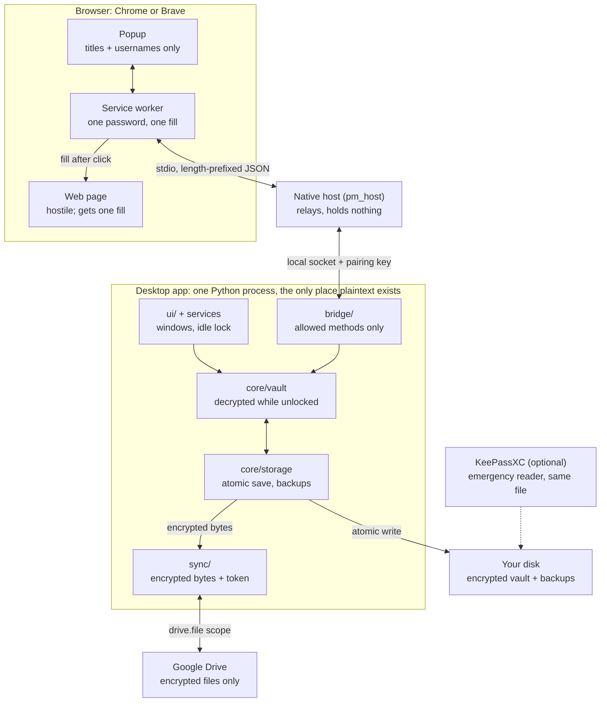

# Architecture

> Source: design pack v0.1, section 4. Status: accepted at gate G0 (2026-10-15).

One desktop process holds every decrypted secret. Everything else (the browser, the native
host, Google Drive and the backups) only ever sees encrypted bytes, or a single answer to a
single request.

## Overview



## Components

| Component | Runs where | Sees plaintext? | Job |
| --- | --- | --- | --- |
| `core/vault` (`VaultSession`) | Desktop app | Yes, while unlocked | Open, lock, add, edit, delete and search one profile's KDBX file |
| `core/storage` | Desktop app | No, encrypted bytes only | Atomic save, read-back check, rotating backups, recovery |
| `core/profiles` | Desktop app | No | List, create, rename and delete profiles in `profiles.json` |
| `core/generator` | Desktop app | Generates, never stores | Random passwords from `secrets` |
| `ui/` (PySide6) | Desktop app | Shows one entry at a time | Profile picker, unlock, list, forms, settings, sync status, idle timer |
| `sync/` | Desktop app, background thread | No: encrypted bytes and an OAuth token | Upload, download, detect conflicts, retry |
| `bridge/` | Desktop app | Answers narrow questions | Local socket server for the browser; calls only the allowed `VaultSession` methods |
| Native host (`pm_host`) | Separate process started by the browser | Relays one password per fill, holds nothing | Converts browser stdin/stdout messages to the local socket |
| Extension service worker | Browser | One password, for one fill, in memory only | Holds the native port, routes messages, injects the fill |
| Extension popup | Browser | Titles and usernames for this site | The only extension UI |
| Google Drive | Google | Never | Stores encrypted `.kdbx` files and their revisions |
| KeePassXC (optional) | Your computer or phone | When you open a vault in it | Emergency reader and recovery tool |

## Layer rules

These rules are enforced in CI by import-linter.

- `core/` never imports Qt, `sync/` or `bridge/`, so core logic can be tested without a
  screen or a network.
- `sync/` never imports `core/vault`. It receives encrypted bytes and a token, nothing else.
  The one exception is the merge step in M6, which goes through a single function that the
  owner reviews.
- `bridge/` may call only the methods listed in the [browser protocol](browser-protocol.md#messages).
- `ui/` talks to core only through `services.py`, never to pykeepass directly.

## Key flows

**Unlock**

1. The app starts and reads `profiles.json` (names and file paths only).
2. You pick a profile and type the master password into the desktop window.
3. `storage` reads the encrypted file, and `VaultSession` decrypts it through pykeepass.
4. The idle timer starts. If the profile is linked to Drive, the sync engine starts.

**Save**

1. The UI sends the change to `VaultSession`.
2. `storage` writes a temp file in the same folder, flushes it to disk, and re-opens it to
   prove it decrypts.
3. The previous file moves into the backup rotation, and the temp file atomically replaces
   the vault.
4. The vault is marked "needs upload". The sync engine uploads it after a 10-second quiet
   period.

**Fill a login**

1. You click the toolbar icon. Through the host and the socket, the popup asks the app for
   logins that match the tab's hostname.
2. The app returns titles and usernames only.
3. You click one. The app re-checks the hostname and returns that one password.
4. The service worker injects a fill function into the tab's top frame, then drops the
   password.

**Lock** (manual, idle timeout or system sleep)

1. `VaultSession` drops its pykeepass object and caches. The clipboard is cleared if it
   still holds a copied password.
2. The sync engine pauses, and the bridge answers every request with `locked`.

## Planned project structure

Files marked `[S]` are security-sensitive. An AI may draft them, but nothing merges without
the owner's line-by-line review.

```text
AGENTS.md                    # rules every AI session reads first
README.md
SECURITY.md                  # threat model link, how to report a problem
LICENSE                      # not present yet: the license is an open decision (ADR-007)
pyproject.toml               # deps + ruff, mypy, pytest, import-linter config
uv.lock                      # hash-pinned dependency lock
.pre-commit-config.yaml
.gitignore
.github/workflows/ci.yml
docs/                        # this documentation, plus later:
  specs/                     # sections 4-8 of the design pack
  adr/                       # architecture decision records
  tasks/                     # one task card per AI session, e.g. M1-03-atomic-save.md
  spikes/                    # M0 spike reports
  manual-tests.md            # M2
  setup-browser.md           # M4
  setup-google-drive.md      # Google Cloud setup guide (M0-04), sync setup (M5)
  recovery.md                # how to get your passwords back, tested in M6
app/
  src/personal_vault/
    __main__.py              # starts the desktop app
    services.py              # the only door from ui/ into core/
    core/
      models.py              # SecretStr, LoginEntry, LoginSummary
      vault.py          [S]  # VaultSession over pykeepass
      storage.py        [S]  # atomic save, read-back check, backups, recovery
      kdf.py            [S]  # Argon2id calibration
      matching.py       [S]  # URL normalisation and site matching
      generator.py      [S]
      redaction.py      [S]  # logging filter
      profiles.py
      settings.py
      migrations.py
    ui/                      # PySide6 windows and dialogs
      clipboard.py      [S]  # copy with auto-clear
      idle.py           [S]  # inactivity and sleep lock
    sync/
      decide.py         [S]  # pure decision function
      engine.py              # scheduling, backoff, executor
      drive_client.py        # real Drive REST calls
      fake_drive.py          # in-memory Drive for tests
      oauth.py          [S]
    bridge/
      server.py         [S]  # local socket server
      protocol.py       [S]  # message schemas, validation, dispatch
      pairing.py        [S]
    host/
      pm_host.py        [S]  # native messaging relay
  tests/
    unit/ integration/ security/ sync/ e2e/ fixtures/
extension/
  manifest.json background.js popup.html popup.js popup.css api.js
  fill.js               [S]
  detect.js             [S]
  test-pages/                # hostile HTML fixtures for e2e tests
scripts/
  check.py                   # runs every lint, type and test check
  install_native_host.py
  dev_reset.py               # wipes the DEV data folder only
```

Two conventions keep development safe:

- `PV_DATA_DIR` points the app at a data folder. Tests and dev runs always set it to a
  throwaway folder, so no development session can touch a real vault.
- Real vault use starts only after gate G2. Until then, every vault on the machine holds
  fake data.

The two hardest parts are specified separately: [Drive sync](sync.md) and the
[browser protocol](browser-protocol.md).
